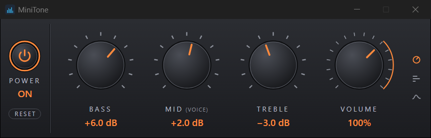
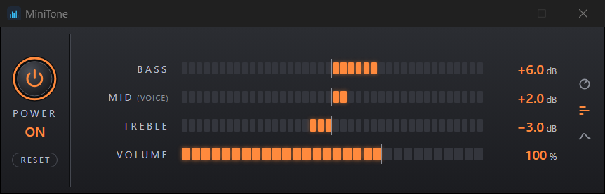
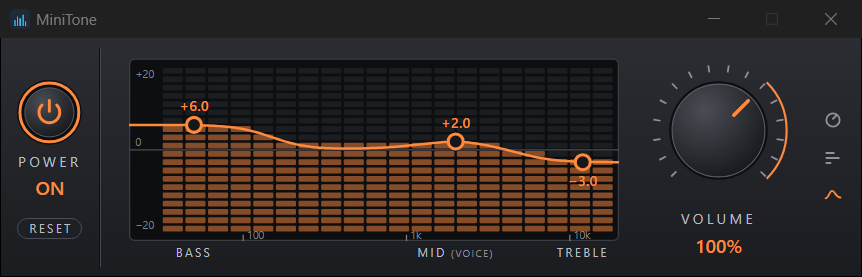

# MiniTone

Bass, Mid, Treble and Volume knobs for everything that plays on Windows 11. The tone control applies to all audio — browsers, games, music players — not to one app.







MiniTone installs its own Audio Processing Object (APO) into the Windows audio engine. **Read [Before you install](#before-you-install) first**: it turns off a Windows signature check and changes the audio path.

## Status

Work in progress. It has only been run on the author's PC (Windows 11 25H2, x64).

- What it does: Bass, Mid and Treble by ±20 dB, Volume from 0 to 150%. One button returns to the original sound. It stays in the system tray.
- The installer is on the [Releases](https://github.com/akiraak/minitone/releases) page.
- See [Not verified](#not-verified) for what has not been tested.

## Before you install

MiniTone puts its own component (an APO) into the Windows audio path. Installing it changes the following.

- **It turns off a Windows signature check.** It sets `DisableProtectedAudioDG` = 1 under `HKLM\SOFTWARE\Microsoft\Windows\CurrentVersion\Audio`. The APO is not signed, and Windows will not load it otherwise.
  - Side effect: apps that require a protected audio path (DRM-protected playback, for example) may stop producing sound.
  - [Equalizer APO](https://sourceforge.net/projects/equalizerapo/) uses the same setting.
- **It adds values to the registry of each output device.** The CLSID of the APO is written to the device's `FxProperties`.
- **It restarts the Windows audio service (`audiosrv`).** Sound that is playing stops for a moment during install and uninstall.
- It needs administrator rights.

The APO runs inside the Windows audio engine (`audiodg.exe`). A bug in the APO can stop all sound on the PC. If that happens, remove it as described in [Uninstall](#uninstall).

## How it works

```
App (Tauri 2)  ──writes──▶  settings file  ◀──reads──  APO (inside audiodg.exe)
 turn a knob                 settings.txt               applies the filters
```

- **APO** (`apo/`, C++): a DLL loaded by the audio engine. It checks the settings file every 250 ms and applies changes without a restart.
- **App** (`app/`, Rust + plain HTML / CSS / JavaScript): it only writes the knob values to the settings file. It does not process audio and does not need administrator rights.
- **Settings file**: `C:\ProgramData\akiraak-minitone\config\settings.txt`

```
enabled=1
volume=1.250
preamp=0.0
limit=1
lowshelf=150,6.0,0.707
band=2000,2.0,0.7
highshelf=5000,-3.0,0.707
```

| Line | Meaning |
| --- | --- |
| `enabled` | 0 = original sound (bypass) |
| `volume` | Volume multiplier. 1.0 is the original volume, 1.5 is 150% |
| `preamp` | Overall gain in dB. The app writes 0 |
| `limit` | 1 = automatically reduce the boost of boosted filters so that the output stays below full scale |
| `lowshelf` | Bass. Frequency (Hz), gain (dB), Q. Raises or lowers everything below the frequency |
| `highshelf` | Treble. Raises or lowers everything above the frequency |
| `band` | Mid. Raises or lowers only the area around a center frequency. The app writes one at 2 kHz; more work if you write them by hand |

If the file is missing or broken, audio passes through unchanged.

## Requirements

- Windows 11 (x64). Windows on Arm is not supported, and the installer refuses to run there. Windows 10 has not been tested.
- WebView2 runtime (included in Windows 11)

## Install

Download `MiniTone-setup.exe` from the [latest release](https://github.com/akiraak/minitone/releases/latest) and run it. Each release lists the SHA-256 of the installer.

- Windows asks for administrator approval (UAC).
- The installer is not signed, so Windows SmartScreen shows a warning. Choose "More info" → "Run anyway".
- It puts the app in `C:\Program Files\MiniTone`, registers the APO, and attaches it to every active output device. Sound stops for a moment.
- It saves the registry as it was before the change to `C:\ProgramData\akiraak-minitone`.

Then start MiniTone from the Start menu. Press the power button on the left to turn it on, and turn the knobs.

- The three small icons on the right switch between the knob view, the LED bar view and the curve view.
- Knobs: drag left or right, use the mouse wheel, or use the arrow keys. Hold Shift while dragging for fine steps.
- Bars: click a position on a bar to set that value, or drag along it. The mouse wheel and the arrow keys work too.
- Mid is centered at 2 kHz, the range that makes voices easier to hear. The panel labels it "MID (VOICE)".
- Curve: drag the Bass, Mid and Treble points up or down. The line shows the filters that are applied, and the LED columns behind it follow the line. Volume stays a knob. The mouse wheel and the arrow keys work too.
- Double-click a knob, a bar or a point to return it to the center (0 dB, 100%). The RESET button under the power button returns all four knobs to the center.
- The close button keeps the app in the system tray. To quit, right-click the tray icon and choose "Quit".
- MiniTone does not start with Windows. The APO keeps applying your settings while the app is not running; start the app only when you want to change them.

### Updating

There is no automatic update. To update, download the newer `MiniTone-setup.exe` and run it over the installed version. Your settings are kept. Sound stops for a moment while the APO is replaced.

## Uninstall

Open Windows Settings → Apps → Installed apps and uninstall MiniTone.

This detaches the APO from the output devices, removes its registration, restores `DisableProtectedAudioDG` to what it was before the install, and deletes the DLL and the app. The registry backup and your settings stay in `C:\ProgramData\akiraak-minitone`.

To get the original sound back right away without uninstalling, turn the power button off, or change the first line of the settings file to `enabled=0`.

## Build

You need the Visual Studio C++ build tools, the Windows SDK (tested with 10.0.26100) and Rust (1.90 or later). Run these in PowerShell on Windows.

```powershell
powershell -ExecutionPolicy Bypass -File apo\build.ps1
powershell -ExecutionPolicy Bypass -File app\build-installer.ps1
```

- `apo\build.ps1` builds the DLL and runs the tests.
- `app\build-installer.ps1` builds the app and creates an installer that bundles the DLL and the registration scripts.
  - It needs the Tauri CLI (version 2). The top of the script explains how to install it.
- The installer is written to your Downloads folder as `MiniTone-setup.exe`.
- To build and try only the app, use `app\build.ps1`. It writes `MiniTone.exe` to your Downloads folder.
- Intermediate build files and the development copies of the registration scripts go to `%LOCALAPPDATA%\akiraak-minitone-dev`.

## Development scripts

You can register and remove only the APO, without the installer. Run these in an administrator PowerShell.

```powershell
cd $env:LOCALAPPDATA\akiraak-minitone-dev
powershell -ExecutionPolicy Bypass -File .\install-apo.ps1 -AllDevices
powershell -ExecutionPolicy Bypass -File .\uninstall-apo.ps1
```

- With `-DryRun`, the scripts change nothing and only print what they would change.
- Without `-AllDevices`, `install-apo.ps1` attaches the APO only to the current default output device.
- The installer calls these same two scripts.

## Limitations

- **The APO has to be attached to each output device.** A device you start using after the install (a new Bluetooth headset, for example) is not affected at first. The app shows a notice that it does not work on that device yet; press "Enable" in the notice and answer "Yes" to the Windows prompt. This is needed once per device, and sound stops for a moment.
- **Reinstalling a driver detaches it**, because the device gets a new ID. A major Windows update can also detach it.
- **Some audio is not affected.** Apps that play in exclusive mode, through ASIO, or in RAW mode bypass the APO.
- **In loud passages, the Bass, Mid and Treble boost is reduced.** A full boost would push the signal past digital full scale, the Windows limiter would kick in, and the overall volume would waver. To prevent this, the APO automatically reduces the boost of the boosted band so that the output stays below full scale. The overall volume does not change, and quiet passages get the full boost.
- **Volume above 100% can make the sound waver or distort** on loud material, because it exceeds full scale.
- The settings are shared by all output devices. Speakers and headphones cannot have separate settings.
- If a driver registers its APO in the old format (one APO per stage) and that stage is already taken, MiniTone does not attach to that device.

## Not verified

- Any PC other than the author's. (Install, install over an existing version, and uninstall restoring the previous state were verified on the author's PC.)

## Troubleshooting

- **The knobs do nothing.** Check that the power button is on. If the app shows a notice that it is not active on the current device, press "Enable". Apps that use exclusive mode, ASIO or RAW mode are not affected (see [Limitations](#limitations)).
- **The knobs stopped working after a driver or Windows update.** The APO was detached. Press "Enable" in the app, or run the installer again.
- **An app or streaming service is silent.** It may require the protected audio path that MiniTone turns off. Uninstalling MiniTone restores the setting.
- **There is no sound at all.** Uninstall MiniTone from Windows Settings; this removes the APO from every device. Then restart the PC.

The APO writes its log to `C:\ProgramData\akiraak-minitone\minitone_apo.log`. If the sound does not change, check whether the log has entries from `audiodg.exe`.

### Reporting a problem

Open an issue at <https://github.com/akiraak/minitone/issues> and include:

- the Windows version and build (`winver`)
- the output device (built-in speakers, USB, Bluetooth, HDMI, …) and its driver if you know it
- what you did and what happened
- the contents of `minitone_apo.log`

## License

MIT. MiniTone does not contain any code from Equalizer APO (GPL v2).

The app is built with open-source Rust crates. Their license notices are installed next to the app as `THIRD-PARTY-NOTICES.txt`.
